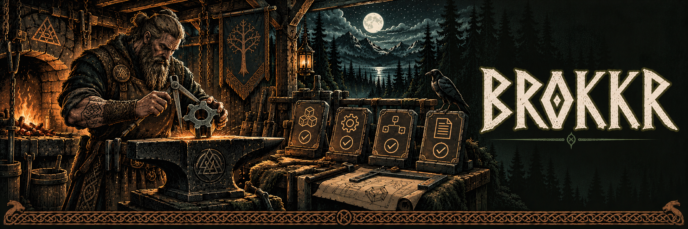

# Brokkr

Open source engineering harness platform: versioned harnesses, skill
resolution, provider adapters (Claude Code, Codex, generic), deterministic
verification with policy enforcement, and evidence backed reports.
Standalone CLI + SDK. Works without Mimir, Sindri, or HerdR; both of those
products consume `@brokkr/sdk`.

Brokkr never orchestrates agents. Mimir runs crews; Sindri plans; HerdR hosts
sessions. Brokkr answers: how must this be built, and how do we prove it?

Status: 0.1.0 local alpha, phases 1 to 6
(registry, skill resolution, adapters, CLI, verification, policy, evidence and
reports, public SDK, built in harness library, integration examples, local release).

## Quick start

```sh
pnpm install && pnpm build
node apps/cli/dist/bin.js init --cwd path/to/repo          # recommend harnesses, write config + lock
node apps/cli/dist/bin.js skills resolve --task task.json  # explain skill selection
node apps/cli/dist/bin.js prepare --provider claude-code --task task.json
node apps/cli/dist/bin.js verify --cwd path/to/repo        # run checks, write .brokkr/runs/run_<ulid>/
node apps/cli/dist/bin.js report --latest --format html > report.html
node apps/cli/dist/bin.js runs prune --keep 10
```

Or install a local release: `pnpm release:local && scripts/install-local.sh` (puts
`brokkr` in `~/.local/bin`), then `brokkr doctor`.

`verify` resolves the configured harnesses (or `--profile`), checks the lockfile,
evaluates policy, runs each check as an argv array in its own session with a
filtered environment, and writes `report.json`, `report.md`, logs and an
HMAC signed evidence manifest to `~/.brokkr/runs/<workspace hash>/run_<ulid>/`
(outside the workspace). Verdicts: `passed`, `failed`, `incomplete` (a required
check could not run, or nothing actually ran and passed) or `blocked` (policy
denial, untrusted harness, tampered or missing lock, secret in output). Ctrl C
cancels the running check, keeps the partial report and exits 130.

Trust modes (ADR-003): by default the CLI runs in `developer` mode for your own
repository. To verify work you do not trust (an agent's worktree), use
`verify --untrusted-workspace --config <file> --lock <file> [--exceptions <file>]
[--policy <file>] [--approver <id>]`: nothing that defines "verified" is read from
the workspace, workspace harnesses never run, and a missing lock blocks.
Approval exceptions: ADR-006. The local executor is not an OS sandbox (ADR-004).

Every command accepts `--json` and `--cwd`. Exit codes: 0 ok, 1 verification
failed, 2 invalid config, 3 infrastructure error, 4 policy denied, 130
interrupted. Decisions: `docs/adrs/`.

## SDK

```ts
import { Brokkr } from "@brokkr/sdk";
const brokkr = new Brokkr({ cwd: repo, executor }); // executor optional
const selection = await brokkr.resolve({ task, profile: "frontend-strict" });
await brokkr.prepare({ selection, provider: "claude-code" });
const report = await brokkr.verify({ selection, workspace: worktree, onEvent });
```

`pnpm pack:local` writes the tarballs to `dist-packages/`; `pnpm smoke:pack`
installs them into a temp consumer. See `docs/sdk.md` and `examples/`.

## Documentation

| Topic                                              | File                                                |
| -------------------------------------------------- | --------------------------------------------------- |
| Getting started                                    | `docs/getting-started.md`                           |
| Writing harnesses and skills                       | `docs/harness-authoring.md`, `docs/skills.md`       |
| Policies and exceptions                            | `docs/policies-and-exceptions.md`                   |
| Verification and reports                           | `docs/verification-and-reports.md`                  |
| SDK (generated API: `pnpm docs:api` → `docs/api/`) | `docs/sdk.md`                                       |
| Security model and limits                          | `docs/security.md`, `docs/limits.md`, `SECURITY.md` |
| Compatibility and release                          | `docs/compatibility.md`, `CHANGELOG.md`             |
| Backlog and gate results                           | `docs/issues/`, `docs/gates/`                       |
| Contributing                                       | `CONTRIBUTING.md`, `CODE_OF_CONDUCT.md`             |

License: Apache-2.0. Free, no paid tier, no telemetry.

## Experimental release status

The planned public source tag is `v0.1.0`. See [release scope and setup](RELEASE-v0.1.0.md) for tested behavior and acceptance limits. Manual accessibility testing is pending. Vendor integrations without authenticated live acceptance remain experimental.
